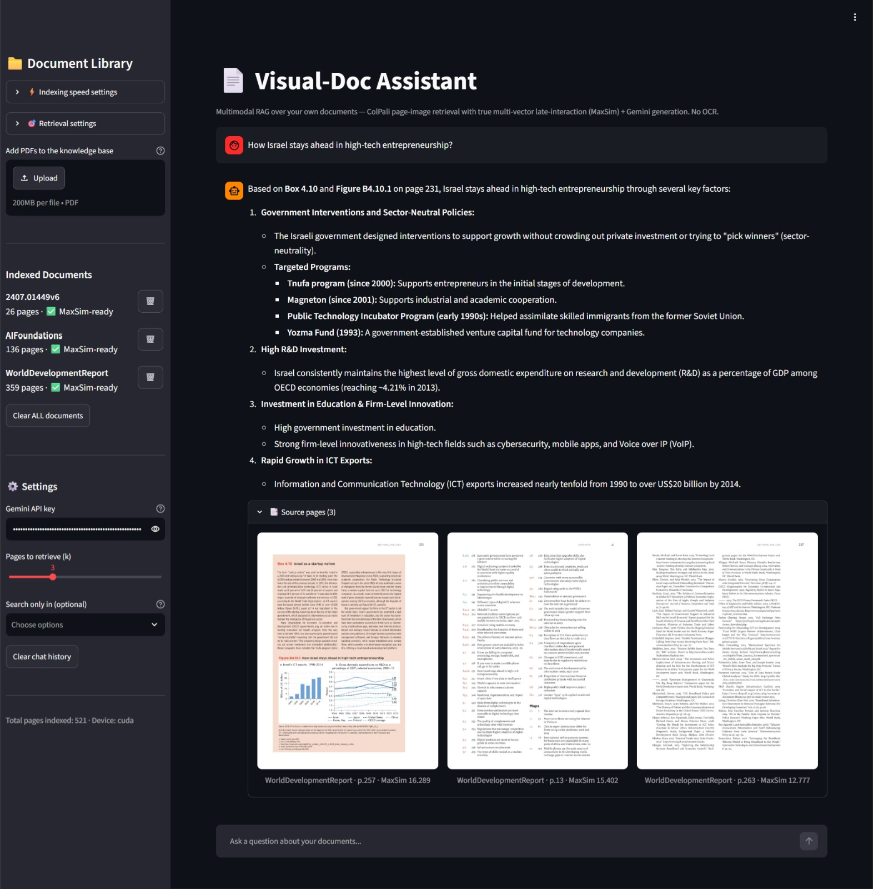
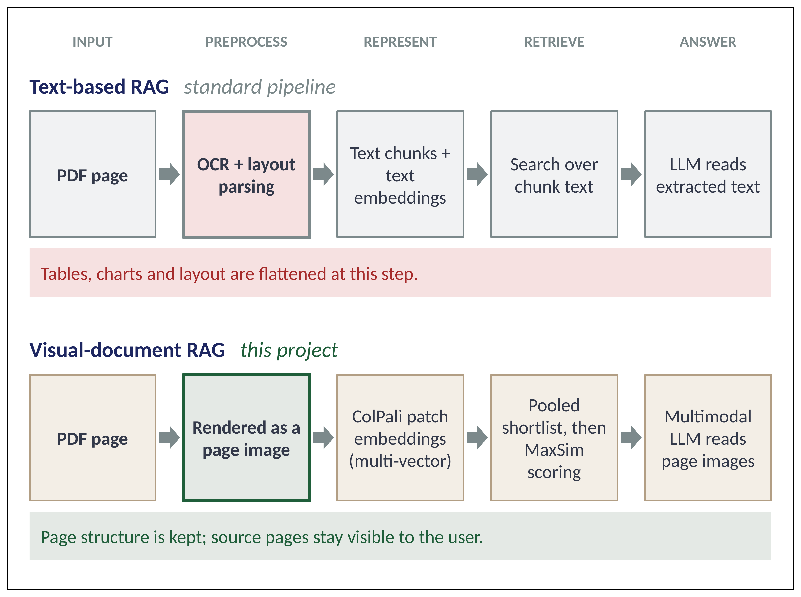
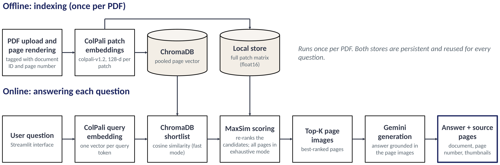
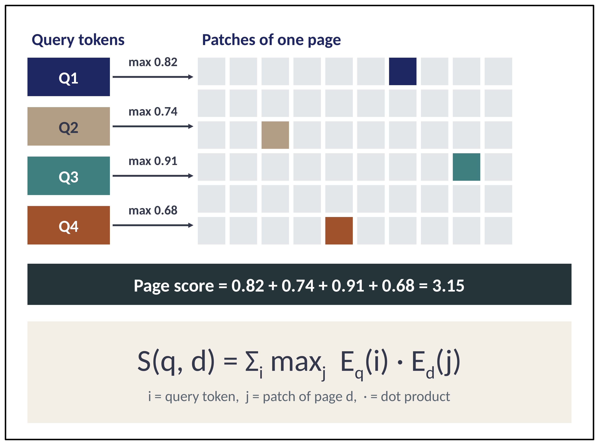

# Visual-Doc Assistant

**A multimodal RAG system for question answering over technical PDFs, with no OCR.**
Upload PDFs, ask a question, and get an answer together with the exact source pages it came from.

Every page is rendered as an image and embedded with [ColPali](https://arxiv.org/abs/2407.01449) (multi-vector, late interaction). Pages are ranked with exact **MaxSim** scoring, and **Gemini** answers from the retrieved page images only. Built as a Minor Project (MC460502), Department of Computer Science and Engineering, NIT Patna.

<p align="center">
  
</p>

## Why visual retrieval?

Tables, charts and layout often carry the answer, and OCR plus text chunking flattens them before retrieval even starts. Treating each page as an image keeps that structure.

<p align="center">
  
</p>

## How it works

<p align="center">
  
</p>

1. **Index (once per PDF):** render pages to images, embed each page with `vidore/colpali-v1.2` (about 1,031 patch vectors of 128 dimensions), store a mean-pooled vector in ChromaDB and the full float16 patch matrix on disk.
2. **Retrieve:** encode the question into token vectors, shortlist candidates by pooled cosine (fast mode) or score every page (exhaustive mode), then rank with exact MaxSim: `S(q, d) = sum_i max_j <E_q(i), E_d(j)>`.
3. **Answer:** send the top-k page images to Gemini with an instruction to answer only from them and to say so when the answer is missing. The UI shows the answer next to its source pages.


<p align="center">
  
</p>
<p align="center"><em>MaxSim on a toy example: each query token keeps its best-matching patch, and the scores are summed.</em></p>

RAG, ColBERT and ColPali are published work. This repository is an independent end-to-end implementation: the pipeline, the multi-PDF app that shows source pages, and the evaluation.

## Results

Evaluated on **30 hand-verified questions over 3 documents (521 pages)**, searched as one combined index with no per-document filter. Full details are in the notebooks and in `evaluation/results/`.

| Metric | Value |
|---|---|
| Recall@1 / @3 / @10 | 86.7% / 96.7% / 100% |
| MRR@10 / nDCG@5 | 0.910 / 0.921 |
| End-to-end answer accuracy (Gemini, top-1 page) | 90.0% (27/30) |
| Accuracy when the right page was ranked first | 100% (26/26) |

**What mattered most: MaxSim scoring.** On the same questions, mean-pooled cosine ranked the right page first only 36.7% of the time; exact MaxSim reached 86.7%.

**ColPali vs OCR-based retrieval (same questions, same generator):**

| Method | Recall@1 | MRR@10 |
|---|---|---|
| ColPali + MaxSim | 86.7% | 0.910 |
| OCR + BM25 | 76.7% | 0.836 |
| OCR + hybrid (BM25 + dense) | 46.7% | 0.697 |
| OCR + dense (bge-small) | 36.7% | 0.576 |

The gap is statistically clear against dense and hybrid search (sign-test p = 0.0003 and 0.0042) but **not established against BM25** (p = 0.45) with only 30 questions. ColPali also costs much more: about 258 KB per page vs 3.4 KB of text, and a 17 s query-encoding time on a CPU.

### Limitations (read before citing the numbers)

- 30 questions is small, and the set is chart-heavy (15 charts, 7 tables, only 3 text questions). Wilson 95% interval for final accuracy: 74.4% to 96.5%.
- Most questions name a figure or table, which helps keyword search too.
- OCR baselines used Tesseract output, not the PDF's own text layer.
- The LLM judge is from the same model family as the generator; three verdicts were overridden by hand.
- Timings were measured on a CPU-only runtime. Indexing time per page was not measured (the ColPali paper reports 0.39 s/page).

## Repository layout

```
app/                  Streamlit app (upload PDFs, ask questions, see source pages)
notebooks/            01 PDF -> images | 02 ColPali embeddings | 03 MaxSim + app
                      04 Evaluation 1 (system) | 05 Evaluation 2 (OCR vs ColPali)
evaluation/
  eval_metrics.py     Shared metric and scoring code used by both evaluations
  results/            Frozen benchmark (qa_set.json, hash 6057af19ccde7e1c) and result files
docs/images/          Figures used in this README
```

## Run the app

Requirements: Python 3.10+, [Poppler](https://poppler.freedesktop.org/) (for `pdf2image`), and a **GPU is strongly recommended**. ColPali is a roughly 3B-parameter model (about 6 GB download on first load), and encoding a question took about 17 s on a CPU.

```bash
pip install -r requirements.txt
export VISUALDOC_DATA_DIR=./data      # where page images and the index are stored
streamlit run app/app.py
```

Enter your own **Gemini API key** in the sidebar (get one at [aistudio.google.com/apikey](https://aistudio.google.com/apikey)); it is used for the session and not stored. You can also set `GEMINI_API_KEY` in the environment.

> The app and notebooks were developed on Google Colab. The notebooks still use Colab and Google Drive paths, and `app.py` defaults to the original Drive location when `VISUALDOC_DATA_DIR` is not set.

## Reproduce the evaluation

The notebooks are written for Colab (`pip install -r requirements-eval.txt` for a local setup) and need the source PDFs, which are not redistributed here: the ColPali paper ([arXiv 2407.01449](https://arxiv.org/abs/2407.01449)), the World Bank *World Development Report* and the World Bank *AI Foundations* report. The questions, gold pages and per-question results are in `evaluation/results/`.

## Roadmap

- Hosted demo where users bring their own API key
- REST API layer (FastAPI) around retrieval and answering
- Multi-vector search engine for larger collections, GPU timing, a text-layer baseline and more questions

## Team

Aryan Tiwari, Anant Pandey, Harsh Chhapre. Supervised by Dr. Devarani Devi Ningombam, NIT Patna.

## References

Lewis et al., RAG (NeurIPS 2020) · Khattab and Zaharia, ColBERT (SIGIR 2020) · Faysse et al., ColPali (ICLR 2025) · Ma et al., DSE (EMNLP 2024) · Yu et al., VisRAG (ICLR 2025).

Released under the MIT License.
